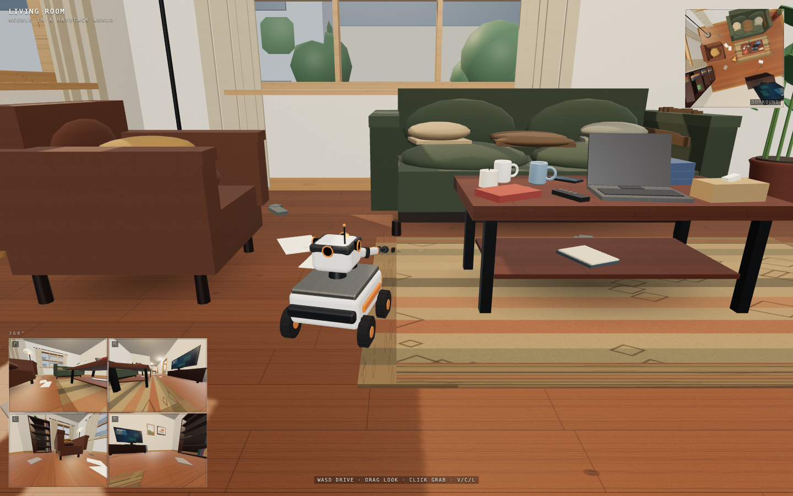

# needle-in-haystack-world

A messy six-room apartment you explore as a 7 kg sweeper robot with a K12-class 3-DOF arm and 360° vision. Everything has weight.

Live: <https://hanxiao.io/needle-in-haystack-world/>



## Stack

- three.js 0.187 (WebGL2, PBR, shadow maps, procedural textures)
- Rapier 0.21 (`@dimforge/rapier3d-compat`, WASM inlined) — rigid bodies, real kg masses (171/171 audited), fixed-joint grasping, kinematic character controller with a custom mass-aware push model
- Vite 8 + `vite-plugin-singlefile` → one self-contained `dist/index.html` (~4.9 MB, no external assets)

## Controls

| Input | Action |
| --- | --- |
| `W A S D` | drive (camera-relative, differential drive) |
| `Shift` | boost (0.55 m/s) |
| drag mouse | orbit camera |
| move mouse | aim / highlight objects |
| wheel | zoom |
| click / `Space` | grab, place, or push |
| `C` | toggle 360 feeds |
| `V` | first / third person |
| `L` | day / night |
| `H` / `R` | hint / reset |
| `V` | first / third person |
| `C` | 360 feeds |
| `L` | day / night |
| `H` | toggle hint |
| `R` | reset |

The robot is a 7 kg sweeper base (350 mm, 2 driven 70 mm wheels + caster, 0.40 m/s, 0.55 boost) with a 3-DOF arm: 0.5 kg payload, 0.34 m reach, 320°/s joints. It can lift a mug/book/plate but not a laptop or kettle; heavy furniture (sofa 85 kg, fridge 95, wardrobe 120) is effectively immovable — 2 s of boost pushing moves it <1 mm, while a 5.5 kg chair slides ~0.45 m. The arm reaches coffee-table height, not the dining table. A sewing needle (1.2 g) is hidden somewhere.

The mouse cursor targets objects in third person; the 360° surround view (front/right/left/back + top-down minimap with robot heading) is always live, and the minimap draws a colour-coded trajectory (cyan slow → amber → pink fast). A live control panel highlights pressed keys and current modes. `V` toggles a clean first-person view.

## Develop

```bash
npm install
npm run dev            # http://127.0.0.1:5173/
npm run build          # dist/index.html (single file)
npm run serve          # serve dist at http://127.0.0.1:4173/
node tools/shot.mjs http://127.0.0.1:4173/ qa/shots/page.png
```

## Deploy

Source lives here (private). The built single file is published into the public
`hanxiao/hanxiao.github.io` Pages repo under `needle-in-haystack-world/index.html`,
so it serves at `https://hanxiao.io/needle-in-haystack-world/` without touching the homepage.

```bash
node tools/deploy.mjs
```

## Layout

```
src/core/    engine: physics, materials, renderer, camera, config
src/world/   apartment shell, furniture, clutter (scene-smith)
src/robot/   rover model, drive controller, arm IK, 360 cameras (robot-smith)
src/ui/      lean HUD
src/main.js  input, fixed-step loop, interaction, QA hooks
qa/          automated functional + visual review
```
